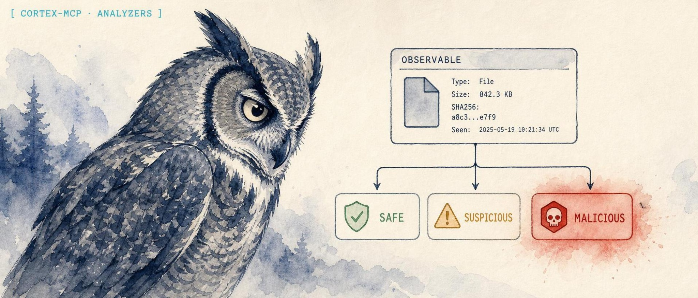

<p align="center">
  
</p>

<p align="center">
  <a href="https://lidless.dev"></a>
</p>
<h1 align="center">cortex-mcp</h1>

<p align="center">
  <strong>An MCP server that lets an AI client run Cortex observable analysis and response, end to end.</strong>
</p>

<p align="center">
  <strong>Website:</strong> <a href="https://lidless.dev/cortex-mcp">https://lidless.dev/cortex-mcp</a>
</p>

<p align="center">
  
  
  
  
</p>

cortex-mcp is a Model Context Protocol (MCP) server for [Cortex](https://docs.strangebee.com/cortex/), the observable analysis and active-response engine from StrangeBee/TheHive Project. It exists because analysts already drive Cortex by hand through its web UI or raw REST API, and an AI client can do that work faster: detonate an indicator across every applicable analyzer, aggregate the taxonomy verdicts, and pull artifacts without anyone clicking through a dozen jobs. It differs from a generic HTTP bridge by exposing Cortex's real domain model as 30 typed MCP tools, auto-detecting observable data types, fanning out analysis with a cap, and gating every destructive action (responders, deletes, file reads) behind explicit confirmation.

## What it does

cortex-mcp connects an MCP-capable AI client (Claude Desktop, Claude Code, Codex CLI, OpenClaw, Hermes, and others) to a running Cortex instance so the model can perform real observable analysis and threat-intelligence enrichment. Cortex is the analyzer/responder engine in the StrangeBee and TheHive SOAR stack: it runs analyzers against observables (IPs, domains, URLs, file hashes, emails, files) and executes responders against TheHive entities. This server speaks Cortex's REST API and projects the full pipeline as MCP tools, resources, and prompts, so an agent can browse analyzer definitions, enable and configure them, submit observables, wait for job reports, extract IOC artifacts, and triage alerts. Auto-detection classifies an observable's data type before analysis, bulk analysis fans out across applicable analyzers and aggregates the taxonomy results, and superadmin tools cover organization and user/API-key management. The result is conversational observable analysis: ask "what does Cortex think of `185.220.101.42`?" and get an aggregated multi-analyzer verdict back.

## Prerequisites

- Node.js 20 or later
- A running Cortex instance (v3.x recommended)
- A Cortex API key with appropriate permissions

## Installation from source

If you prefer to run from a checkout instead of `npx`:

```bash
git clone https://github.com/lidless-labs/cortex-mcp.git
cd cortex-mcp
npm install
npm run build
```

Then point your client at the built binary (see the per-client recipes below).

## Try it (copy-paste MCP client config)

Add this to your MCP client config (this example is Claude Desktop's `claude_desktop_config.json`; the same `command`/`args`/`env` shape works for Claude Code, Codex, OpenClaw, and Hermes). It runs the published npm package directly with `npx`, no clone or build required:

```json
{
  "mcpServers": {
    "cortex": {
      "command": "npx",
      "args": ["-y", "thehive-cortex-mcp"],
      "env": {
        "CORTEX_URL": "http://cortex.example.com:9001",
        "CORTEX_API_KEY": "your-org-admin-key",
        "CORTEX_SUPERADMIN_KEY": "your-superadmin-key"
      }
    }
  }
}
```

The npm package is named [`thehive-cortex-mcp`](https://www.npmjs.com/package/thehive-cortex-mcp); it installs a `cortex-mcp` binary. Set `CORTEX_SUPERADMIN_KEY` only if you want the organization and user management tools.

## Usage

### Claude Code

```bash
claude mcp add cortex \
  --env CORTEX_URL=http://cortex.example.com:9001 \
  --env CORTEX_API_KEY=your-org-admin-key \
  --env CORTEX_SUPERADMIN_KEY=your-superadmin-key \
  -- npx -y thehive-cortex-mcp
```

Add `--scope user` to make it available from any directory instead of only the current project.

### OpenClaw

```bash
openclaw mcp set cortex '{
  "command": "npx",
  "args": ["-y", "thehive-cortex-mcp"],
  "env": {
    "CORTEX_URL": "http://cortex.example.com:9001",
    "CORTEX_API_KEY": "your-org-admin-key",
    "CORTEX_SUPERADMIN_KEY": "your-superadmin-key"
  }
}'
```

If you are running from a source checkout instead, point `command`/`args` at the built `dist/index.js`:

```bash
openclaw mcp set cortex '{
  "command": "node",
  "args": ["/absolute/path/to/cortex-mcp/dist/index.js"],
  "env": {
    "CORTEX_URL": "http://cortex.example.com:9001",
    "CORTEX_API_KEY": "your-org-admin-key",
    "CORTEX_SUPERADMIN_KEY": "your-superadmin-key"
  }
}'
```

Then restart the OpenClaw gateway so the new server is picked up:

```bash
systemctl --user restart openclaw-gateway
openclaw mcp list   # confirm "cortex" is registered
```

### Hermes Agent

[Hermes Agent](https://github.com/NousResearch/hermes-agent) reads MCP config from `~/.hermes/config.yaml` under the `mcp_servers` key. Add an entry:

```yaml
mcp_servers:
  cortex:
    command: "npx"
    args: ["-y", "thehive-cortex-mcp"]
    env:
      CORTEX_URL: "http://cortex.example.com:9001"
      CORTEX_API_KEY: "your-org-admin-key"
      CORTEX_SUPERADMIN_KEY: "your-superadmin-key"
```

Then reload MCP from inside a Hermes session:

```
/reload-mcp
```

### Codex CLI

[Codex CLI](https://github.com/openai/codex) registers MCP servers via `codex mcp add`:

```bash
codex mcp add cortex \
  --env CORTEX_URL=http://cortex.example.com:9001 \
  --env CORTEX_API_KEY=your-org-admin-key \
  --env CORTEX_SUPERADMIN_KEY=your-superadmin-key \
  -- npx -y thehive-cortex-mcp
```

Codex writes the entry to `~/.codex/config.toml` under `[mcp_servers.cortex]`. Verify with:

```bash
codex mcp list
```

### Standalone

```bash
export CORTEX_URL=http://cortex.example.com:9001
export CORTEX_API_KEY=your-org-admin-key
npx -y thehive-cortex-mcp     # or `npm start` from a source checkout
```

## MCP Tools (30)

### Status

| Tool | Description |
|------|-------------|
| `cortex_get_status` | Get Cortex instance health, version, and configuration |

### Analyzer Tools

| Tool | Description |
|------|-------------|
| `cortex_list_analyzers` | List all enabled analyzers, optionally filtered by data type |
| `cortex_get_analyzer` | Get details about a specific analyzer by ID |
| `cortex_run_analyzer` | Submit an observable to a specific analyzer for analysis |
| `cortex_run_analyzer_by_name` | Run an analyzer by name instead of ID (convenience wrapper) |
| `cortex_run_analyzer_file` | Submit a file to an analyzer. `filePath` is confined to `CORTEX_FILE_BASE_DIR` (disabled if unset); or pass `fileBase64` |

### Analyzer Definition Tools

| Tool | Description |
|------|-------------|
| `cortex_list_analyzer_definitions` | Browse all available analyzer definitions with filtering (by data type, free/no-config, search) |
| `cortex_enable_analyzer` | Enable an analyzer definition in the current org with configuration |
| `cortex_disable_analyzer` | Disable (remove) an enabled analyzer (destructive; requires `confirm=true`) |

### Job Tools

| Tool | Description |
|------|-------------|
| `cortex_get_job` | Get the status and details of an analysis job |
| `cortex_get_job_report` | Get the full report of a completed analysis job |
| `cortex_wait_and_get_report` | Wait for a job to complete and return the report |
| `cortex_list_jobs` | List recent analysis jobs with optional filters |
| `cortex_get_job_artifacts` | Get artifacts (extracted IOCs) from a completed job |
| `cortex_delete_job` | Delete a specific job (destructive; requires `confirm=true`) |
| `cortex_cleanup_jobs` | Bulk delete jobs by status or age (with dry-run) |

### Responder Tools

| Tool | Description |
|------|-------------|
| `cortex_list_responders` | List all enabled responders, optionally filtered by data type |
| `cortex_run_responder` | Execute a responder action against a TheHive entity (destructive; requires `CORTEX_ALLOW_DESTRUCTIVE=1` and `confirm=true`) |

### Responder Definition Tools

| Tool | Description |
|------|-------------|
| `cortex_list_responder_definitions` | Browse all available responder definitions with filtering |
| `cortex_enable_responder` | Enable a responder definition with configuration |
| `cortex_disable_responder` | Disable (remove) an enabled responder (requires `confirm=true`) |

### Bulk Operations

| Tool | Description |
|------|-------------|
| `cortex_analyze_observable` | Run analyzers against an observable (auto-detected data type) and aggregate taxonomy results. Pass an `analyzers` allowlist, or `fanOut=true` to run all applicable analyzers (capped by `CORTEX_MAX_FANOUT`) |

### Organization Management (superadmin)

| Tool | Description |
|------|-------------|
| `cortex_list_organizations` | List all organizations |
| `cortex_get_organization` | Get organization details |
| `cortex_create_organization` | Create a new organization |
| `cortex_update_organization` | Update organization description or status |

### User Management (superadmin)

| Tool | Description |
|------|-------------|
| `cortex_list_users` | List all users across organizations |
| `cortex_get_user` | Get user details |
| `cortex_create_user` | Create a new user in an organization |
| `cortex_renew_user_key` | Rotate a key through an operator-configured credential store (requires `confirm=true`, returns a receipt) |

## MCP Resources (4)

| URI | Description |
|-----|-------------|
| `cortex://analyzers` | Enabled analyzers with capabilities |
| `cortex://analyzer-definitions` | All available analyzer definitions with config requirements |
| `cortex://responder-definitions` | All available responder definitions with config requirements |
| `cortex://jobs/recent` | Last 50 analysis jobs |

## MCP Prompts (4)

| Prompt | Description |
|--------|-------------|
| `analyze-observable` | Guided workflow for analyzing an observable through Cortex |
| `investigate-ioc` | Deep investigation workflow for a suspicious IOC |
| `setup-cortex` | Guided setup wizard for fresh Cortex instances (enable free analyzers, configure API keys) |
| `triage-alert` | Structured alert triage workflow with multi-observable analysis and risk assessment |

## Configuration

| Variable | Required | Default | Description |
|----------|----------|---------|-------------|
| `CORTEX_URL` | Yes | - | Absolute HTTP or HTTPS base URL without embedded credentials, query string or fragment (e.g., `http://cortex.example.com:9001`) |
| `CORTEX_API_KEY` | Yes | - | API key for normal operations (org admin level) |
| `CORTEX_SUPERADMIN_KEY` | No | - | Superadmin API key for org/user/definition management |
| `CORTEX_MODE` | No | `read-only` | Accepts `read-only` or `write`. All state changes, including analyzer submissions and administration, require `write`. Read-only POST job searches remain available. |
| `CORTEX_ALLOW_PRIVATE_TARGETS` | No | `false` | Accepts `true` or `false`. Explicit operator permission to submit private or special-purpose network targets. Public network targets are checked after DNS resolution. |
| `CORTEX_VERIFY_SSL` | No | `true` | Accepts `true` or `false` (case-insensitive). Set to `false` to skip SSL verification. Applied via a scoped HTTP dispatcher for Cortex requests only; it does **not** disable TLS verification process-wide. |
| `CORTEX_TIMEOUT` | No | `30` | Request timeout as a positive integer from 1 to 300 seconds. Wait-report calls (`cortex_wait_and_get_report`, and `cortex_analyze_observable` while it waits for reports) instead allow their requested `timeout` plus 10 seconds, if that is longer. |
| `CORTEX_FILE_BASE_DIR` | No | - | Absolute base directory that `cortex_run_analyzer_file` may read files from. `filePath` is confined to this directory (realpath checked to defeat symlink/`..` escapes); paths outside it are refused. When unset, reading files by path is **disabled** and you must submit file content via `fileBase64`. |
| `CORTEX_ALLOW_DESTRUCTIVE` | No | `0` | Set to `1` (or `true`) to permit responder execution and deletion of jobs, analyzers or responders. Requires write mode. |
| `CORTEX_MAX_FANOUT` | No | `10` | Positive safe integer from 1 to 9,007,199,254,740,991. Maximum number of analyzers `cortex_analyze_observable` will submit to in a single call when fanning out. Invalid values fail at startup. |

### Security and safety gates

This server can trigger real-world actions and submit observables to third-party services, so several capabilities are secured by default:

- **Arbitrary file reads are blocked.** `cortex_run_analyzer_file` only reads files inside `CORTEX_FILE_BASE_DIR` (realpath-confined to defeat symlink/`..` escapes). With no base dir configured, path-based reads are refused; use `fileBase64` to submit content explicitly.
- **Writes are opt-in.** Set `CORTEX_MODE=write` before submitting analysis or changing configuration. POST job searches remain available in read-only mode.
- **Responders are gated.** `cortex_run_responder` requires both `CORTEX_ALLOW_DESTRUCTIVE=1` in the environment **and** `confirm=true` in the call.
- **Changes require confirmation where indicated.** User creation with roles, key rotation, organization locking, responder removal, job deletion, analyzer removal and cleanup with `dryRun=false` require `confirm=true`. Deletion and responder execution also require `CORTEX_ALLOW_DESTRUCTIVE=1`.
- **Bulk analysis is conservative.** `cortex_analyze_observable` does **not** fan out to every analyzer by default. Pass an explicit `analyzers` allowlist, or set `fanOut=true` to run all applicable analyzers (capped by `CORTEX_MAX_FANOUT`).
- **SSL verification is scoped.** Disabling `CORTEX_VERIFY_SSL` relaxes TLS only for Cortex connections, never for the whole Node process.

### Result and input limits

Responses are limited to 4 MiB while streaming. JSON request bodies are limited to
1 MiB, incoming MCP message lines to 16 MiB before parsing, and file uploads to 10 MiB. Path-based files must be regular files within
the configured base directory. Text arguments are limited to 65,536 characters,
with a separate encoded-file limit. Tool and resource data is JSON-quoted inside
escaped `untrusted_cortex_data` blocks, limited to 64 KiB with a truncation marker.
Resources use `text/plain` for that envelope. Upstream error bodies and status text
are omitted. Credential-bearing configuration and serialized parameters are omitted. Common
credential fields are redacted from structured results.

### Credential delivery and worker networking

The Proxmox installer reads keys silently, sends credentials through stdin, and
stores them with owner-only permissions for systemd `LoadCredential`. The server
reads `cortex-api-key` and `cortex-url` from `CREDENTIALS_DIRECTORY` when their
respective environment variables are absent. Environment configuration still works.

For embedded use, pass an operator-approved `CredentialStore` adapter as the second
`CortexClient` constructor argument. Its `put(userId, key)` method must persist the
key without logging it and return a non-secret reference. Rotation returns only
that reference and a SHA-256 fingerprint. A failed store write is reported without
key material. If it fails after renewal, recover through Cortex administration.

Network-target validation covers IP, domain, FQDN and HTTP/HTTPS URL submissions.
URL credentials and unsupported schemes are refused. DNS checks have a five-second
budget and reject any private or special-purpose answer unless explicitly permitted.
Configure the Cortex workers' network policy to enforce the same destination rules
on every connection, including redirects and later DNS resolutions. Submission-time
checks cannot enforce worker-side redirects or DNS changes. Cortex API redirects are
refused by the client.

## Examples

### Set up analyzers from scratch

```
1. Use cortex_list_analyzer_definitions with freeOnly=true to find analyzers
   that need no API keys.
2. Use cortex_enable_analyzer to enable "Abuse_Finder_3_0" with empty config.
3. Use cortex_analyze_observable with data "8.8.8.8" and fanOut=true to run
   all applicable analyzers (or pass analyzers ["Abuse_Finder"] to scope it).
```

### Auto-detect observable type

```
Use cortex_analyze_observable with data "185.220.101.42" and fanOut=true
(no dataType needed - auto-detects as IP). Or pass an `analyzers` allowlist
to limit which analyzers run.
```

### Clean up old failed jobs

```
Use cortex_cleanup_jobs with status "Failure", dryRun true to preview,
then dryRun false and confirm true to delete (requires write mode and destructive permission).
```

### Analyze a file

```
Set CORTEX_FILE_BASE_DIR=/srv/cortex-uploads in the server environment, then:
Use cortex_run_analyzer_file with analyzerId "Yara_3_0",
filePath "/srv/cortex-uploads/suspicious.exe" to scan with YARA rules.
(Paths outside CORTEX_FILE_BASE_DIR are refused; alternatively pass fileBase64.)
```

### Manage API keys

```
Key retrieval is unavailable. Rotation requires write mode, confirm=true and an
operator-configured credential store adapter. The stock stdio server has no adapter
and refuses rotation before contacting Cortex. Manage keys through Cortex administration
until a store adapter is configured.
```

### Triage a security alert

```
Use the triage-alert prompt with alertDescription "Suspicious outbound traffic
detected" and observables "185.220.101.42, evil.example.com, 44d88612fea8a8f36de82e1278abb02f"
```

## Supported Data Types

| Type | Examples | Auto-detected |
|------|----------|---------------|
| `ip` | `8.8.8.8`, `2001:db8::1` | yes |
| `domain` | `example.com` | yes |
| `url` | `https://malware.example.com/payload` | yes |
| `hash` | MD5, SHA1, SHA256, SHA512 | yes |
| `mail` | `user@example.com` | yes | <!-- content-guard: allow email -->
| `fqdn` | `mail.example.com` | As domain |
| `filename` | `malware.exe` | Manual |
| `registry` | `HKLM\Software\Malware` | Manual |
| `file` | Binary file uploads | Manual |
| `other` | CVEs, custom types | Manual |

## Deployment

### Proxmox LXC

```bash
bash -c "$(wget -qLO - https://raw.githubusercontent.com/lidless-labs/cortex-mcp/main/scripts/proxmox_install.sh)"
```

### Release publishing

The tag workflow uses npm trusted publishing and provenance. Configure the package's
trusted publisher for `lidless-labs/cortex-mcp` and `.github/workflows/ci.yml` on npm
before the next release. The workflow uses Node 24 and grants OIDC permission only
to the publish job. It does not use an npm token. Changing this workflow does not
publish a release or configure the npm account.

## Why not something else?

- **The Cortex web UI** is built for one analyst clicking through jobs by hand. cortex-mcp puts the same engine behind an AI client, so analysis, taxonomy aggregation, and artifact extraction happen conversationally instead of through a dozen page loads.
- **A raw REST wrapper or generic HTTP MCP bridge** gives a model an untyped endpoint and no domain knowledge. cortex-mcp models analyzers, responders, jobs, definitions, organizations, and users as 31 typed tools with auto data-type detection, capped fan-out, and built-in safety gates, so the agent works in Cortex's vocabulary rather than reconstructing the API from scratch.
- **Wiring Cortex into a SOAR runbook or n8n flow** is great for fixed, pre-authored pipelines. This server is for the open-ended path: ad hoc enrichment, investigation, and triage where the analyst (or the agent) decides the next step as results come in.
- **thehive-mcp** (the companion server) drives case and alert management in TheHive. cortex-mcp is the analysis-and-response layer; the two are complementary, not substitutes.

## What cortex-mcp is not

- It is **not** a Cortex replacement or a reimplementation of analyzers. It calls a Cortex instance you already run; Cortex still does the analysis.
- It is **not** a SIEM, a case manager, or a TheHive client. Case and alert workflows belong to TheHive (see thehive-mcp).
- It is **not** an autonomous responder. Destructive actions (responders, job deletion, file reads by path) are off or confirmation-gated by default and never fire silently.
- It is **not** a hosted service. It runs locally as a stdio MCP server next to your client; nothing is sent anywhere except the Cortex instance you configure.

## Testing

```bash
npm test              # Unit tests
npm run test:watch    # Watch mode
npm run lint          # Type check

# Integration tests (requires live Cortex instance)
CORTEX_URL=http://cortex.example.com:9001 \
CORTEX_API_KEY=your-key \
CORTEX_SUPERADMIN_KEY=your-superadmin-key \
npx vitest run tests/integration.test.ts
```

Live lifecycle tests also require `CORTEX_TEST_MUTATIONS=true`, `CORTEX_MODE=write`
and `CORTEX_ALLOW_DESTRUCTIVE=1`. Use a disposable Cortex instance for these tests.
They remove the analyzers and responders they create and report cleanup failures.

## Project Structure

```
cortex-mcp/
  src/
    index.ts                  # MCP server entry point
    config.ts                 # Environment config + validation
    client.ts                 # Cortex REST API client (full surface)
    types.ts                  # Cortex API type definitions
    resources.ts              # MCP resources (4)
    prompts.ts                # MCP prompts (4)
    tools/
      analyzers.ts            # Analyzer tools (list, get, run, run-by-name)
      analyzer-definitions.ts # Definition browsing, enable, disable
      jobs.ts                 # Job management + cleanup
      responders.ts           # Responder tools (list, run)
      responder-definitions.ts # Definition browsing, enable, disable
      bulk.ts                 # Bulk analysis with auto-detect
      status.ts               # Health/version check
      organizations.ts        # Org CRUD (superadmin)
      users.ts                # User CRUD + key management (superadmin)
  tests/
    client.test.ts            # API client unit tests
    tools.test.ts             # Tool handler unit tests
    integration.test.ts       # Live instance integration tests
  scripts/
    proxmox_install.sh        # Proxmox LXC deployment script
```

## Contributing

Issues and pull requests are welcome. See [CONTRIBUTING.md](CONTRIBUTING.md) for the contribution path and [SECURITY.md](SECURITY.md) for reporting vulnerabilities. By participating you agree to the [Code of Conduct](CODE_OF_CONDUCT.md).

## License

MIT. See [LICENSE](LICENSE).

---

<p align="center"><a href="https://lidless.dev">Part of <strong>Lidless Labs</strong></a> &middot; the eye does not close</p>

<p align="center"><sub><strong>Security / SOC:</strong> <a href="https://github.com/lidless-labs/soc-stack">soc-stack</a> &middot; <a href="https://github.com/lidless-labs/wazuh-mcp">wazuh-mcp</a> &middot; <a href="https://github.com/lidless-labs/misp-mcp">misp-mcp</a> &middot; <a href="https://github.com/lidless-labs/suricata-mcp">suricata-mcp</a> &middot; <a href="https://github.com/lidless-labs/thehive-mcp">thehive-mcp</a> &middot; <a href="https://github.com/lidless-labs/mitre-mcp">mitre-mcp</a> &middot; <a href="https://github.com/lidless-labs/zeek-mcp">zeek-mcp</a> &middot; <a href="https://github.com/lidless-labs/hotwash">hotwash</a></sub></p>

<p align="center"><sub><a href="https://lidless.dev">All tools</a> &middot; <a href="https://github.com/lidless-labs">Lidless Labs on GitHub</a></sub></p>
